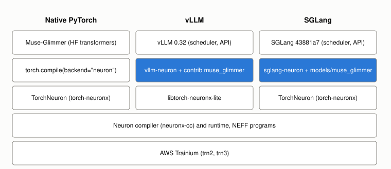
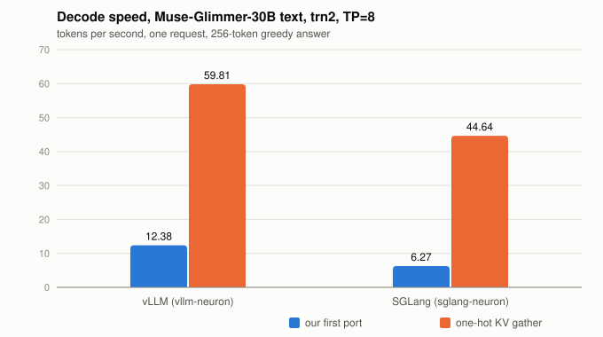

# Serving Muse-Glimmer-30B on AWS Trainium with Native PyTorch, vLLM and SGLang

Yahav, November 17, 2026

## TL;DR

Muse-Glimmer-30B serves on Trainium through both major open serving stacks, each with its native Neuron plugin, at
comparable speed and accuracy (trn2.48xlarge, 2 devices, TP=8, one request, 256-token greedy answer):

| Stack | Time to first token | Decode | 256-token answer | GSM8K (100) |
| --- | --- | --- | --- | --- |
| vLLM + vllm-neuron | 0.193 s | 59.81 tok/s | 4.46 s | 0.95 |
| SGLang + sglang-neuron | 0.241 s | 44.64 tok/s | 5.95 s | 0.98 |

- **One model port, two stacks.** The same plain-PyTorch Muse-Glimmer decoder runs in both, each joining as its
  framework's own plugin package, with vLLM and SGLang themselves unmodified.
- **One fix, both stacks.** Our first port read the paged KV cache with an indexed gather that is slow on Trainium. A
  one-hot matmul in its place made decode 4.8× faster on vLLM and 7.1× faster on SGLang, with the same accuracy.
- **Native PyTorch too.** The upstream Hugging Face code runs on TorchNeuron with `torch.compile(fullgraph=True)`:
  15.2 tok/s on trn3 at TP=2, with text, image and video.

Both stacks ran on the same node, with the same device claim and the same clients; every number links to the job that
produced it.

## Introduction

Muse-Glimmer-30B is a 30B vision-language model: text, image and video in, text out. We run it on AWS Trainium three
ways, each with the platform's native pieces: the Hugging Face model code on **TorchNeuron** (native PyTorch for
Trainium), **vLLM** through its Neuron plugin `vllm-neuron`, and **SGLang** through its Neuron plugin `sglang-neuron`.
This post shows how each path works, how we found the one bottleneck our model port had on both serving stacks, and
how to reproduce every number.

## How it works



**Figure 1.** The three stacks. Blue boxes are the plugin packages that carry Muse-Glimmer; everything else ships as is.

- **Native PyTorch.** TorchNeuron is the PyTorch backend for Trainium (`torch-neuronx`). The Hugging Face model runs on
  device `neuron`; `torch.compile(backend="neuron", fullgraph=True)` turns prefill and decode into two Neuron programs
  (NEFFs).
- **vLLM.** vllm-neuron is vLLM's out-of-tree platform plugin, on `libtorch-neuronx-lite`. A model is a contrib package
  with a `vllm.general_plugins` entry point that registers it in every vLLM process; vLLM's scheduler, paged KV cache
  and OpenAI server stay unchanged. The plugin compiles one graph per shape bucket at startup.
- **SGLang.** sglang-neuron is SGLang's platform plugin (`SGLANG_PLATFORM=neuron`), on TorchNeuron. A model is a
  package under `sglang_neuron/models/` plus one catalog entry; the platform points SGLang's model registry at it. Its
  graph runner compiles and warms every prefill and decode shape at startup, so the server never compiles while it
  serves.

In both serving ports the model is a graph module whose forward takes the step's token ids, positions and per-layer
paged-cache metadata (block table, slot mapping), and writes the step's K/V into the pool in place.

## Feature and model coverage

| | Native PyTorch | vLLM + vllm-neuron | SGLang + sglang-neuron |
| --- | --- | --- | --- |
| Text | yes | yes | yes |
| Image | yes | yes (one per prompt) | not yet (`--language-model-only`) |
| Video | yes | yes (one per prompt) | not yet |
| Tensor parallel | TP=2 (stock TP plan, 2 KV heads) | TP=8 measured (KV heads replicated) | TP=8 measured (KV heads replicated) |
| Reasoning split | n/a | `--reasoning-parser muse_glimmer` | `--reasoning-parser muse` |
| Compile | `torch.compile` fullgraph | shape buckets at startup | every shape at startup |
| Where the code lives | this repo (`run_muse_glimmer.py`, `muse_compile.py`) | vllm-project/vllm-neuron `contrib/models/muse_glimmer` | yahavb/sglang-neuron `muse-glimmer-text` |

## 1. Architecture and workloads

| Property | Value |
| --- | --- |
| Decoder | 52 layers, hidden 6656, SwiGLU MLP 19968, vocabulary 202048 |
| Attention | 32 query heads, 2 KV heads, head dim 128; layers repeat [sliding, sliding, sliding, full] |
| Sliding layers | 2048-token window, RoPE (theta 500000) |
| Full layers | no position encoding (NoPE) |
| Vision | a ViT tower and adapter; images and videos become tokens in the prompt |

The model has details a serving port must reproduce exactly: a weight-less RMSNorm after the embedding, four centered
RMSNorms per layer (`x * (1 + w)`, two with eps 1e-8), a gated attention output
(`o_proj(attn * sigmoid(gate_proj(x)))`), a weight-less Q/K RMSNorm with the softmax scale (`3.87 / sqrt(128)`) folded
into Q, and soft-capped logits (`20 * tanh(logits * 0.196 / 20)`). Both serving ports use the same plain-PyTorch
decoder for this; only the stack around it differs.

**Workload.** One request at a time, greedy, context 2048. Latency: the prompt "Explain quantum computing in simple
terms." (63 tokens) with a 256-token answer, median of three warm runs. Accuracy: the first 100 GSM8K test questions,
5-shot, with SGLang's few-shot GSM8K prompts sent to `/v1/completions` on both servers
([`scripts/gsm8k_openai.py`](../scripts/gsm8k_openai.py)), plus two known-answer prompts (17 × 23 = 391; the capital of
France) and a determinism check (the same prompt four times must give the same answer).

## 2. Three native paths

### Native PyTorch: TorchNeuron

TorchNeuron registers Trainium as a PyTorch device, so the `transformers` code runs as is, eager or under
`torch.compile(backend="neuron", fullgraph=True)`. Getting to zero graph breaks took three changes, all in
[`muse_compile.py`](../muse_compile.py):

- **Text decoder.** The stock sliding-window cache keeps a Python-int length and recompiles every step. Every layer uses a
  full-length `StaticLayer` instead, and the sliding mask enforces the window: two graphs, prefill and decode.
- **Vision tower.** Its 20 graph breaks all come from grid bookkeeping on the host (`.tolist()`, data-dependent shapes).
  We precompute that metadata on the host and run window attention as one SDPA call under a block-diagonal mask
  (fp32-equivalent to stock within 2.6e-6).
- **Tensor parallel.** We create the process group without `device_id`, since `DeviceMesh` otherwise calls `split_group`,
  which the Neuron backend does not support. With 2 KV heads the stock TP plan stops at TP=2.

| Rung (trn3, TP=2, 256 tokens) | Decode |
| --- | --- |
| text, eager | 3.3 tok/s |
| text, `fullgraph=True` | 15.2 tok/s |
| image, text and vision compiled | 15.3 tok/s |
| video, text and vision compiled | 15.1 tok/s |

Source: [RESULTS.md](../RESULTS.md). This path is the reference: it is the upstream model code, and the serving ports
are checked against its math.

### vLLM: the vllm-neuron contrib model

vllm-neuron is vLLM's out-of-tree platform plugin for Trainium. Muse-Glimmer is a contrib model in
[vllm-project/vllm-neuron](https://github.com/vllm-project/vllm-neuron) (`contrib/models/muse_glimmer`, with a
tutorial). It is a pip package that registers itself in every vLLM process through vLLM's `vllm.general_plugins` entry
point, and serves text, image and video (one image or one video per prompt). Three settings each cost a run to find:
`VLLM_NEURON_BACKEND=neuron_native` (required on the 0.29 image), `NEURON_LOGICAL_NC_CONFIG` equal to the logical core
size the devices are claimed with (vllm-neuron writes 1 when it is unset), and `--reasoning-parser muse_glimmer`, which
splits the reasoning channel from the answer.

### SGLang: a new sglang-neuron model package

sglang-neuron is SGLang's platform plugin for Trainium, built on TorchNeuron. SGLang keeps its own launcher, scheduler
and API; the plugin supplies the device, KV pool, graph runner and models. SGLang already knows the checkpoint: its
config class, the `muse` reasoning parser and `--language-model-only`. The plugin's v0.1.0 graphs take token ids only,
so Muse-Glimmer runs text-only there. The port is one package, `sglang_neuron/models/muse_glimmer`, and one catalog entry,
on [yahavb/sglang-neuron `muse-glimmer-text`](https://github.com/yahavb/sglang-neuron/tree/muse-glimmer-text)
([patch](../patches/sglang-neuron-muse-glimmer.patch)). Two lessons from bring-up: the plugin refuses any environment
variable starting with `SGLANG_NEURON_` that it does not read, and the image's copy of the plugin must be uninstalled
before an editable install, or both copies register SGLang hooks.

## 3. Finding the bottleneck

Our first port decoded at 12.38 tok/s on vLLM and 6.27 tok/s on SGLang. Both stacks ran the same Muse-Glimmer decoder
code, so we profiled that code rather than the stacks.

**The device was busy the whole time.** We captured SGLang's system trace with `/start_profile` (activity `NEURON`).
It showed one decode program per token, running back to back: 161.3 ms per execution, 161.3 ms start to start, with
no host gaps. The step's 106 collectives took 1.5 ms of that. So the time was spent inside the compiled program.

**The cost grew with the KV pool.** By default SGLang sizes its pool to fill the memory left after the weights:
305K tokens (7.56 GB per rank). vLLM's job holds 16,384 tokens (512 blocks of 32). With `--max-total-tokens 16384`,
SGLang decoded at 11.18 tok/s, byte-identical answers. Something in the step scaled with the size of the cache it read.

**The device profile named it.** We captured two decode steps with the plugin's serve-window profile
(`SGLANG_NEURON_PROFILE_SERVE_RANKS=0`) and broke the instruction table down by engine and source line. It reported
91 ms per step, and GpSimd was the busiest engine at 51% of the window. Its top lines were the two KV gathers,
`self.k_cache[block_table]` and `self.v_cache[block_table]`: **at least 95 ms of GpSimd time over the two steps**, plus
matching copy and transpose instructions on the scalar, vector and tensor engines. On Trainium a gather through a
runtime block table runs as software-generated dynamic DMA (the `DMA_DIRECT2D` instructions on GpSimd in the profile).

## 4. The one-hot KV gather

Each row's pages can be selected with a matmul instead of an index:

```python
# before: dynamic DMA through the block table
kc = k_cache[table].permute(0, 2, 1, 3, 4).reshape(B, 1, nblk * page, d)

# after: static reads of the whole pool and a small tensor-engine matmul
onehot = (table.unsqueeze(-1) == torch.arange(pages).view(1, 1, pages)).to(torch.bfloat16)  # [B, nblk, pages]
kc = (onehot @ k_cache.view(pages, page * d)).view(B, 1, nblk * page, d)
```

Every output element is a single `1 * x` term. The pool starts as zeros and only ever holds finite K/V, so the other
terms are exact zeros, and the matmul picks out the same bf16 values in the same order. The cost moves from tiny,
irregular DMAs to one sequential read of the pool: 2 × 4.2 MB per layer at a 16K-token pool. The tensor engine has
spare capacity for the extra matmul. It is opt-in (`MUSE_GLIMMER_KV_ONEHOT_GATHER=1`) in both ports. For vLLM it is a
[30-line patch to the public contrib model](../patches/vllm-neuron-muse-glimmer-onehot-kv-gather.patch).

SGLang, cumulative (trn2, TP=8; [results](../results/sglang-text-trn2/README.md)):

| Configuration | Time to first token | Decode | 256-token answer | GSM8K (100) |
| --- | --- | --- | --- | --- |
| our first Muse-Glimmer port, default pool (305K tokens) | 0.642 s | 6.27 tok/s | 41.29 s | not run |
| + KV pool of 16,384 tokens | 0.428 s | 11.18 tok/s | 23.24 s | 0.97\* |
| **+ one-hot KV gather** | **0.241 s** | **44.64 tok/s** | **5.95 s** | **0.98** |

vLLM (same node and settings):

| Configuration | Time to first token | Decode | 256-token answer | GSM8K (100) |
| --- | --- | --- | --- | --- |
| our first Muse-Glimmer port | 0.390 s | 12.38 tok/s | 20.98 s | 0.96 |
| **+ one-hot KV gather** | **0.193 s** | **59.81 tok/s** | **4.46 s** | **0.95** |

\* measured with SGLang's own `python3 -m sglang.test.few_shot_gsm8k` (same prompts, native `/generate`). The one-hot
build scored 0.98 on both clients.

The time to first token also halved. The prefill reads its cached prefix through the same gather, which is the likely
reason; we did not profile the prefill separately.

## 5. End-to-end results



**Figure 2.** Decode tokens per second of our Muse-Glimmer port, first version and with the one-hot KV gather, one
request with a 256-token greedy answer, trn2, TP=8 on 2 devices (LNC2). vLLM 12.38 → 59.81, SGLang 6.27 → 44.64.

| Server (both with the one-hot gather) | Time to first token | Decode | 256-token answer | GSM8K (100) |
| --- | --- | --- | --- | --- |
| vLLM + vllm-neuron | 0.193 s | 59.81 tok/s | 4.46 s | 0.95 |
| SGLang + sglang-neuron | 0.241 s | 44.64 tok/s | 5.95 s | 0.98 |

Accuracy held. The known-answer prompts are identical on every build. GSM8K stays between 0.95 and 0.98, where one
question is 0.01. Every kept build gives the same answer to the same prompt on each of four runs. Long answers do not
match byte for byte across builds and stacks. The one-hot build's reasoning differs from the gather build's from
character 144, and vLLM and SGLang differ from each other from character 317. All of them read coherently.

## 6. What did not work

| Idea | Result | Why we dropped it |
| --- | --- | --- |
| `--model-type=transformer` (vLLM's compile setting) on SGLang | 6.16 vs 6.27 tok/s | no gain, and greedy repeats stopped matching |
| K/V write as rows of a `[slots, d]` view | 6.25 (big pool), 11.11 (16K) tok/s | no change; warm-up's in-place check showed the write was not copied |
| gather pages with `index_select` on `[pages, page*d]` | 10.92 vs 11.18 tok/s | still a dynamic gather |
| attend over the whole pool, mask by the block table's inverse | 50.25 tok/s | the answer depended on where a request's pages sat in the pool |

The last one was the fastest. It summed the softmax in pool order, so the first run of a prompt and a run that reused
cached prefix pages gave different text. The one-hot gather keeps the token order and gives up 11% of that speed.

## 7. Future directions

- **Image and video on SGLang.** sglang-neuron's graphs need an embeddings input and a vision encoder graph first.
- **Larger batches.** The one-hot gather reads the whole pool every step, so its cost grows with the pool, not the
  context. That is cheap for a 16K-token pool and one request. Many concurrent requests need a paged attention kernel
  that reads only the table's pages.
- **Accuracy at full scale.** GSM8K on all 1,319 questions would separate the servers beyond 100 questions.

## 8. Takeaways

- Profile before you optimize. The system trace ruled out host overhead and collectives in one capture, and the device
  profile named the single source line.
- On Trainium, gathers through a runtime index are expensive. When the source is small, a one-hot matmul over the whole
  source swaps irregular DMA for sequential reads and spare tensor-engine work, and stays exact.
- Size the KV pool to the workload. A pool sized to "all free memory" made every decode step pay for memory it never
  used.
- Keep a change only if the answers hold: greedy repeats, known answers and a benchmark, on the same node and client
  as the baseline.

## Get started: configurations and launch commands

**Hardware and software**

| | vLLM | SGLang |
| --- | --- | --- |
| Instance | trn2.48xlarge, 2 devices (LNC2, 8 logical cores), TP=8 | same |
| Image | `public.ecr.aws/neuron/pytorch-inference-vllm-neuronx:0.29.0.1.2.0-neuronx-py314-sdk2.33.0-ubuntu26.04` | `public.ecr.aws/neuron/pytorch-inference-sglang-neuron:v0.1.0-neuron-py314-sdk-2.33.0-ubuntu26.04` |
| Neuron SDK | 2.33 | 2.33 (neuronx-cc 2.28.7631, torch-neuronx 2.14.3) |
| Framework | vllm-neuron branch `muse-glimmer-30b` (fb32962b, vLLM 0.32) + the one-hot patch | SGLang 43881a7, sglang-neuron fork `muse-glimmer-text` (f607a28) |
| Kubernetes job | [`muse-glimmer-30b-vllm-text-job.yaml`](../muse-glimmer-30b-vllm-text-job.yaml) | [`muse-glimmer-30b-sglang-job.yaml`](../muse-glimmer-30b-sglang-job.yaml) |

**vLLM**

```bash
git clone https://github.com/vllm-project/vllm-neuron && cd vllm-neuron
git apply /path/to/Muse-Glimmer-30B/patches/vllm-neuron-muse-glimmer-onehot-kv-gather.patch
pip install -e contrib/models/muse_glimmer

export VLLM_NEURON_BACKEND=neuron_native NEURON_LOGICAL_NC_CONFIG=2 MUSE_GLIMMER_KV_ONEHOT_GATHER=1
vllm serve meta-models/Muse-Glimmer-30B --served-model-name Muse-Glimmer-30B \
  --host 127.0.0.1 --port 8000 --tensor-parallel-size 8 --max-model-len 2048 \
  --max-num-seqs 1 --max-num-batched-tokens 1024 --num-gpu-blocks-override 512 \
  --reasoning-parser muse_glimmer --default-chat-template-kwargs '{"reasoning_strength": "low"}' \
  --additional-config '{"neuron_config": {"num_batched_tokens_buckets": [1024], "num_seqs_buckets": [1]}}'
```

**SGLang**

```bash
git clone -b muse-glimmer-text https://github.com/yahavb/sglang-neuron && cd sglang-neuron
pip uninstall -y sglang-neuron && pip install --no-deps --no-build-isolation -e .

export SGLANG_PLATFORM=neuron MUSE_GLIMMER_KV_ONEHOT_GATHER=1
python3 -m sglang.launch_server --model-path meta-models/Muse-Glimmer-30B --served-model-name Muse-Glimmer-30B \
  --language-model-only --host 127.0.0.1 --port 30000 --tp-size 8 --context-length 2048 \
  --chunked-prefill-size 1024 --max-running-requests 1 --max-total-tokens 16384 --mem-fraction-static 0.6 \
  --reasoning-parser muse --default-chat-template-kwargs '{"reasoning_strength": "low"}'
```

**Benchmarks** (the same commands against either port, 8000 or 30000)

```bash
python3 scripts/sglang_text_client.py --url http://127.0.0.1:30000 --model Muse-Glimmer-30B --max-tokens 256 --runs 4
python3 scripts/gsm8k_openai.py --url http://127.0.0.1:30000 --model Muse-Glimmer-30B --num-questions 100
```

**Profiling** (SGLang)

```bash
# system trace of any window
curl -X POST http://127.0.0.1:30000/start_profile -H 'Content-Type: application/json' \
  -d '{"activities": ["NEURON"], "output_dir": "/tmp/profile"}'
# ... one request ...
curl -X POST http://127.0.0.1:30000/stop_profile
# device profile of two decode steps on rank 0, set at launch
export SGLANG_NEURON_PROFILE_SERVE_RANKS=0 SGLANG_NEURON_PROFILE_SERVE_START=16 SGLANG_NEURON_PROFILE_SERVE_STEPS=2
neuron-explorer view -n <decode.neff> -s <profile.ntff> --output-format summary-json
```

## Acknowledgments

Thanks to the TorchNeuron, vllm-neuron and sglang-neuron teams for platform plugins that let a new model join as one
package, and to the SGLang community for already carrying Muse-Glimmer's config, reasoning parser and language-only
mode.
